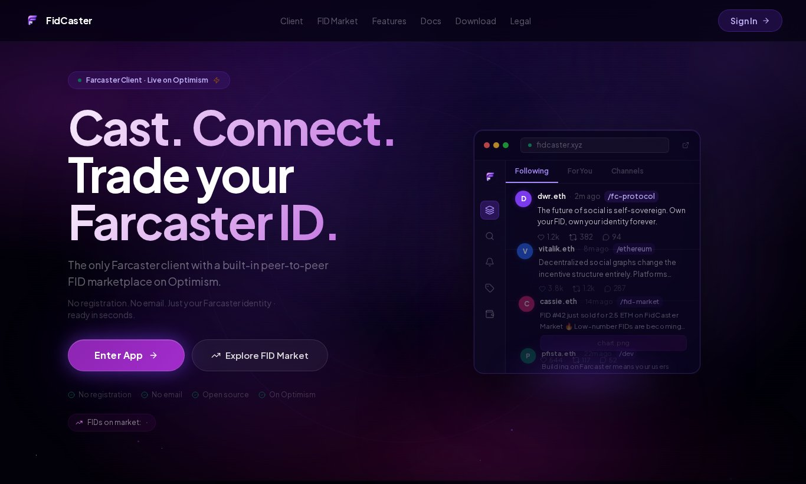
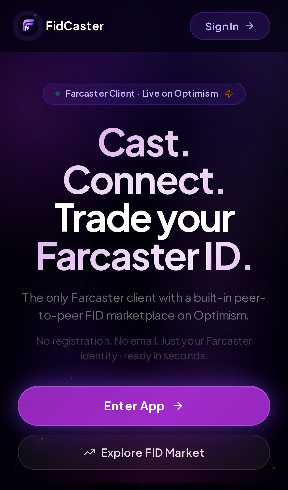

<h1 align="center">FidCaster</h1>

An independent client for <a href="https://farcaster.xyz">Farcaster</a>, the open social protocol, with a built-in peer-to-peer marketplace for Farcaster IDs.

<a href="https://fidcaster.xyz">fidcaster.xyz</a> · <a href="https://docs.fidcaster.xyz">Docs</a> · <a href="https://farcaster.xyz/fidcaster">Farcaster</a> · <a href="https://x.com/fidcaster">X</a>

> **This is the public overview of FidCaster.** The application source code lives in a private repository, because it includes the production server and admin tooling for a live product that handles real users, wallets and marketplace trades. Read access for reviewers is available on request: **support@fidcaster.xyz**.

## Status

- Live in production at [fidcaster.xyz](https://fidcaster.xyz): on the web, as a Farcaster mini app, and as an Android app
- About 2,000 users
- Built and maintained by one developer, self-funded, over the past 8 months

## What it does

- **Full Farcaster client:** feeds, casts, replies, channels, notifications, direct messages, bookmarks, search and multiple accounts
- **Stories** and customizable profile themes
- **Pulse:** a curated news view of what's happening on Farcaster
- **Built-in wallet:** EVM chains via viem plus Solana, with swaps and WalletConnect
- **Mini apps:** opens Farcaster mini apps inside the client, with wallet requests shown and approved by the user
- **FID Market:** buy, sell and track Farcaster ID listings, settled onchain on Optimism
- **Growth tools:** quality-filtered discovery and follow tools, plus Neynar quality scores on profiles

## Engineering highlights

- **Protocol-native writes.** Farcaster messages are built and Ed25519-signed on the user's device and submitted directly to hubs. Signer keys are registered onchain through EIP-712 signed key requests on Optimism, and private keys are zeroed from memory after signing.
- **Keys stay on the device.** The local key vault is encrypted with AES-GCM-256 using a PBKDF2-derived key (200,000 iterations). FidCaster never holds a user's seed phrase.
- **No single data source.** Reads go through a normalization layer over Neynar and a Hypersnap hub provider.
- **Mini app host.** A host-side implementation of the Farcaster Mini App SDK (iframe and native in-app browser), with an EIP-1193 wallet bridge that simulates transactions and requires explicit approval.
- **Careful money handling.** Integer-only (bigint) accounting for points and allocations, Merkle-based token distributions verified against the chain, and a crash-safe transaction journal so an interrupted claim is never blindly replayed.
- **Performance.** Code-split routes and lazy loading cut startup JavaScript on mobile from 888 KB to 526 KB gzipped.

More detail in [docs/ARCHITECTURE.md](docs/ARCHITECTURE.md).

## Code samples

A handful of real files from the private repository are in [samples/](samples/README.md): on-device message signing, bigint token allocation with its tests, the Merkle airdrop code, performance utilities and a production React component.

## By the numbers (private repository)

| | |
|---|---|
| Merged pull requests | 615 (since July 2026) |
| TypeScript | ~121,000 lines across 667 source files |
| UI | 172 pages and components |
| Server | 121 API routes |
| Tests | 138 test files, ~640 unit tests, plus Playwright end-to-end specs |

## Stack

TypeScript · React 18 · Vite 7 · Tailwind CSS v4 · Express · PostgreSQL · viem · Farcaster protocol libraries · Capacitor

## Contact

- Email: support@fidcaster.xyz
- Farcaster: [@fidcaster](https://farcaster.xyz/fidcaster)
- X: [@fidcaster](https://x.com/fidcaster)

---

© 2026 FidCaster. This repository contains documentation and selected code samples; the full FidCaster source code is not included.
