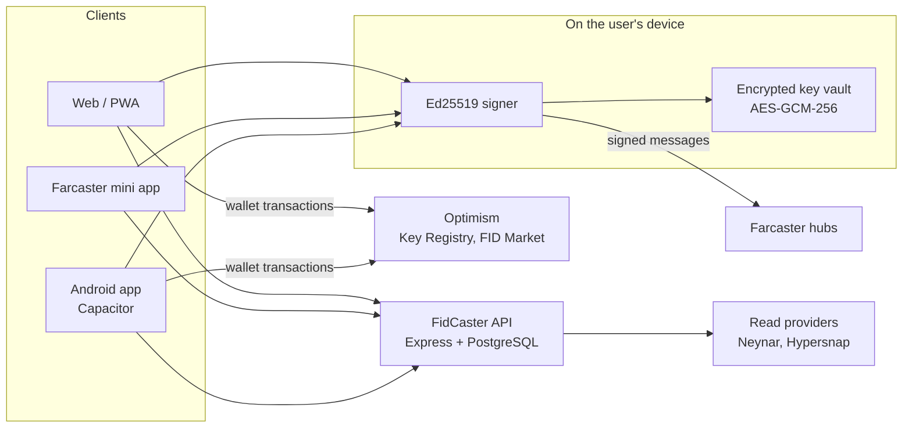

# FidCaster architecture

A high-level view of how FidCaster is built. Source code is in a private repository; this document describes the design only.

## Overview

## Client

- React 18 single-page app built with Vite 7 and Tailwind CSS v4, shared by the web app, the Farcaster mini app and the Capacitor native app.
- Routes and heavy features (wallet, mini app browser, market tools) are code-split and loaded on demand, so the first screen on a phone ships about 526 KB of gzipped JavaScript.
- DOM-observing UI enhancements are coalesced to one animation frame and paused when the page is hidden.

## Identity and signing

- Each account has an Ed25519 signer key generated on the device. Keys are added onchain through the Farcaster Key Registry using EIP-712 signed key requests on Optimism.
- Casts, reactions, follows and profile updates are built and signed locally with the Farcaster protocol libraries and submitted to hubs. Private key bytes are cleared from memory after each signature.
- Keys at rest live in a local vault encrypted with AES-GCM-256, with the key derived by PBKDF2 (200,000 iterations). The server never receives a seed phrase or a signer private key.

## Reads

- Feeds, profiles, channels and notifications are read through a provider layer that normalizes responses from Neynar and from a Hypersnap hub provider into one internal shape, so the client is not tied to a single data source.

## Mini app host

- FidCaster implements the host side of the Farcaster Mini App SDK, in an iframe on the web and in a native in-app browser in the mobile app.
- Wallet requests from mini apps go through an EIP-1193 bridge that simulates the transaction, shows it to the user, and only signs after explicit approval.

## Wallet

- EVM support via viem, plus a Solana portfolio, token swaps and WalletConnect.

## FID Market

- A peer-to-peer marketplace for Farcaster IDs. Listings and purchases settle onchain on Optimism; the client shows listing windows, market activity and seller proceeds.

## Quality

- About 640 unit tests across 138 test files (Node's built-in test runner) and Playwright end-to-end specs.
- Every change ships through a pull request: 615 merged since July 2026.
